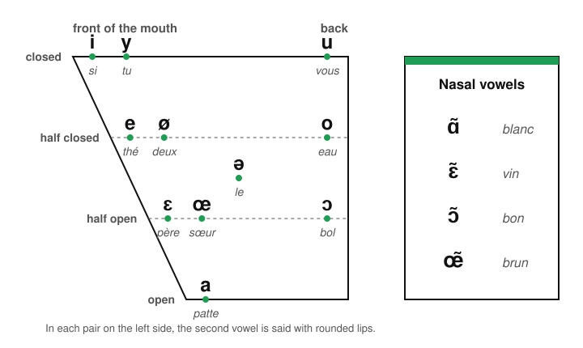

# The vowels a, i, ou and u

<span class="tag tag-sounds">Sounds</span> <span class="tag tag-a1">A1</span>

After this lesson you can say the vowels /a/, /i/, /u/ and /y/, and hear the difference between *tu* and *tout*.

Before this: [How French spelling, sounds and rhythm work](01-french-sound-map.md). You need: a mirror, so you can watch your lips.

## The idea

A **vowel** is a sound made with an open mouth, where the air flows without being blocked. In English you glide through a vowel: "go" slides from one position to another. French vowels are held still. Your lips and tongue stay put for the whole sound, which is why a French vowel sounds shorter and cleaner than an English one.

Two things change one vowel into another: where your tongue is, and whether your lips are rounded. The figure shows the whole French set. This lesson uses the left, top and bottom edges: /i/, /y/, /u/ and /a/. The next lessons fill in the rest.



### The four sounds

| Symbol | Spelling | Example | Lips | Tongue |
|---|---|---|---|---|
| /a/ | a, à | *chat* /ʃa/ (cat) | open, relaxed | low, front |
| /i/ | i, î | *si* /si/ (if), *ici* /isi/ (here) | spread, as in a smile | high, front |
| /u/ | ou | *vous* /vu/ (you), *tout* /tu/ (all) | rounded, tight | high, back |
| /y/ | u, û | *tu* /ty/ (you), *rue* /ʁy/ (street) | rounded, tight | high, front |

/a/ is close to the vowel in English "father", but shorter and further forward. A few words, such as the one for "dough", have a darker /ɑ/ for some speakers. Many speakers do not keep the difference, so say /a/ everywhere.

/i/ is like the vowel in "see", but held still and tense. Do not let it glide into a *y* sound at the end.

/u/ is not the English "oo" in "too" with a glide. It is a pure, tight, rounded sound. Spell it *ou*: the letter *u* alone never says /u/ in French.

### How to make /y/

/y/ does not exist in English, so it needs steps. The spelling is *u*, which is the trap: a French *u* is nothing like an English *u*.

1. Say /i/ (*si*) and keep your tongue where it is, high and at the front, with your lips spread.
2. Without moving your tongue, round your lips tight, as if you were going to whistle or blow out a candle.
3. Keep the sound going. The vowel you hear is /y/.
4. Check in a mirror: lips pushed out, tongue behind the lower front teeth.

If you hear /u/ instead, your tongue has pulled back. Go back to step 1 and keep it forward.

## Hear it

Listen for the lips. In *tu* they are rounded and the tongue is forward. In *tout* the tongue is back. Then listen to the vowels /i/, /y/ and /u/ in a row.

```fr
Tu. Tout. Tu. Tout. | You. All. You. All.
La rue. La roue. | The street. The wheel.
Dessus. Dessous. | Above. Below.
Si. Tu. Vous. | If. You. You.
```

Each pair differs by one vowel. A **minimal pair** is two words that differ in a single sound, and hearing them is the fastest way to find the sound you cannot yet hear. *Rue* /ʁy/ and *roue* /ʁu/ (wheel) is one pair, and *dessus* /dəsy/ and *dessous* /dəsu/ is another. Play each pair three times, then say it. Record yourself and ask: could someone tell my *tu* from my *tout*?

## Try it

1. Which vowel do you hear in each word: *ici*, *vous*, *rue*, *chat*? Name it as /a/, /i/, /u/ or /y/.
2. Say *tu* and *tout* five times each, switching. Which has the tighter, more forward sound?
3. How do you spell the sound /u/? How do you spell /y/?
4. Say *dessus* and *dessous*. Which has the rounded lips with the tongue forward?

<details class="solution" markdown>
<summary>Answer</summary>

1. *Ici*: /i/. *Vous*: /u/. *Rue*: /y/. *Chat*: /a/.
2. *Tu*, /y/, with the tongue forward.
3. /u/ is spelled *ou*. /y/ is spelled *u*.
4. *Dessus* /dəsy/.

</details>

## Say it

```fr
Tu es ici. | You are here.
La rue est petite. | The street is small.
Vous êtes ici. | You are here (polite).
Tout est ici. | Everything is here.
```

<div class="practice" markdown>

## Practice routine (30 min)

| Minutes | Task | What to listen for |
|---|---|---|
| 5 | Anki: today's cards, say each French word before you flip | The vowel in each word |
| 12 | Read the lesson. Make /y/ with the four steps, then do Try it | Whether your lips stay still during the vowel |
| 6 | Play the three minimal pairs, then one Mauril clip | The vowel in *tu* against the vowel in *tout* |
| 7 | Shadow the Hear it lines, then do Say it with the mic | /y/ in *rue* and *tu* |

Repeat this routine on at least three days before you tick the boxes below.

</div>

<div class="move-on" markdown>

## Move on when

- [ ] You can say /y/ on its own with rounded lips and a forward tongue.
- [ ] You can tell *tu* from *tout* and *rue* from *roue* by ear, 8 times out of 10.
- [ ] You can say all four lines of Say it with no stops.

</div>

## Common mistakes

Saying /u/ for *u*. In *tu* the tongue stays forward. Start from /i/ and round your lips.

Gliding at the end of /i/ and /u/ as English does ("see" becomes "see-y"). Hold the vowel still.

Spelling /u/ with a single *u*. The sound /u/ is written *ou*, as in *vous*.

## In Quebec

In Quebec, *t* and *d* before /i/, /y/ and the glides /j/ and /ɥ/ are usually pronounced with a small hiss, so *tu* sounds like [t͡sy] and *du* like [d͡zy]. The OQLF gives examples such as *tulipe* (tulip) [t͡sylip] and *lundi* (Monday) [lœ̃d͡zi] ([OQLF: l'affrication](https://vitrinelinguistique.oqlf.gouv.qc.ca/24467/la-prononciation/phenomenes-phonetiques/laffrication)). It applies inside words too, so *petit* /pəti/ is often [pət͡si].

The same OQLF page names a second habit, the loose (lax) vowels [ɪ] and [ʏ]. Linguistic descriptions say that a short /i/, /y/ or /u/ in a syllable that ends in a consonant sound is often pronounced looser, written [ɪ], [ʏ] and [ʊ] ([Wikipedia: Quebec French phonology](https://en.wikipedia.org/wiki/Quebec_French_phonology)). In *petite* /pətit/ the last vowel is [ɪ], so the word is [pət͡sɪt]. You do not need to say it that way. Learn to hear it, so that [t͡sy] and [ɪ] still sound like *tu* and /i/ to you.

## New words

| French | English | Notes |
|---|---|---|
| *tu* | you (informal) | |
| *vous* | you (polite, or more than one person) | |
| *tout* | all, everything | |
| *la rue* | street | |
| *la roue* | wheel | |
| *ici* | here | |
| *si* | if | |
| *le chat* | cat | |
| *dessus* | above, on top | |
| *dessous* | below, underneath | |

## Key terms

- **Vowel**: a sound made with an open mouth, where the air is not blocked.
- **Minimal pair**: two words that differ in only one sound, such as *tu* and *tout*.

Next: [The e vowels](04-vowels-e-family.md)
