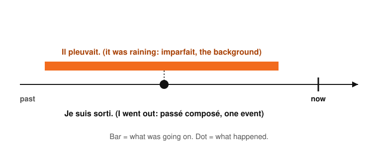

# Imparfait or passé composé

<span class="tag tag-grammar">Grammar</span> <span class="tag tag-a2">A2</span>

After this lesson you can choose between the imparfait and the passé composé when you tell a story, and combine them in one sentence with *quand*, *pendant que* and *alors que*.

Before this: [The imparfait](05-imparfait.md), [The passé composé with avoir](../05-the-past-what-happened/03-passe-compose-avoir.md), [The passé composé with être](../05-the-past-what-happened/05-passe-compose-etre.md), [The passé composé: no, questions and agreement](../05-the-past-what-happened/06-pc-negation-questions-agreement.md). You need: nothing.

## The idea

You now have two past tenses, and a story needs both. A story has a scene and a plot. The **scene** is how things were: the weather, the place, the people, how you felt. The **plot** is what happened, one thing after another.

Picture a line of time going left to right. The passé composé is a dot on the line: an event with a clear start and end, *je suis arrivé*, *il a parlé*. The imparfait is a long bar under the line. It has no marked start and no marked end. It is what was true while the dots happened: *il faisait froid*, *j'étais fatigué*.



### Two questions

When you are unsure, ask two questions about the verb.

1. Is it one event that happened and finished, or a change from one moment to the next? Then use the passé composé: *Je suis entré.* *Elle a téléphoné.* *J'ai pris un café.*
2. Is it a habit, a description, a state, or something already going on when the story starts? Then use the imparfait: *Je buvais un café chaque matin.* *Il faisait froid.* *Elle était fatiguée.*

| Idea | Tense | Example |
|---|---|---|
| single event | passé composé | *Hier, j'ai mangé au restaurant.* |
| repeated habit | imparfait | *Avant, je mangeais au restaurant le vendredi.* |
| scene, weather | imparfait | *Il y avait beaucoup de monde.* |
| state of mind | imparfait | *Je pensais que c'était facile.* |
| a new event | passé composé | *Soudain, un homme a parlé.* |

### Signal words

Some words point to one tense. For the passé composé: *hier*, *un jour*, *une fois*, *soudain*, *tout à coup*, *d'abord*, *ensuite*, *puis*. For the imparfait: *d'habitude*, *toujours*, *souvent*, *chaque jour*, *tous les jours*. A signal word is a help and not a law. The verb's meaning decides: *Hier, il faisait froid* is correct, because the weather is a description even when the day is named.

### An event inside a background

The most common pattern: a background action in the imparfait is cut by an event in the passé composé, joined by *quand*.

*Je mangeais quand mon ami est arrivé.* ("I was eating when my friend arrived.") *Il faisait froid quand je suis sorti.* ("It was cold when I went out.")

Two actions that go on at the same time both take the imparfait. Use *pendant que* ("while") or *alors que* ("while", often with a contrast): *Pendant que tu travaillais, je regardais un film.* ("While you were working, I was watching a film.") Two events one after the other both take the passé composé: *Je suis entré et j'ai pris un café.*

### Verbs of state

Verbs of state say how things were, not what happened: *être*, *avoir*, *penser*, *vouloir*, *pouvoir*. They are very often in the imparfait: *J'étais content.* *Nous avions faim.* *Je pensais que c'était facile.* The passé composé of a verb of state often shows a reaction or a result, a change at one moment: *J'ai eu peur* ("I got scared"), *Je n'ai pas pu dormir* ("I did not manage to sleep"). Compare *Je ne pouvais pas dormir* ("I couldn't sleep", the situation). Compare also *Je voulais partir* ("I wanted to leave", the state) with *J'ai voulu partir* ("I tried to leave").

A few verbs change meaning between the two tenses. You will meet *savoir* in Savoir, connaître, dire, lire and écrire<!-- link: ../07-pronouns-and-getting-things-done/05-savoir-connaitre-dire-lire-ecrire.md -->, and its imparfait and passé composé differ in the same way.

Watch out: these rules have exceptions, and native speakers sometimes choose either tense to show how they see an event. Learn the two questions, then read and listen for more examples.

## Hear it

Listen for the endings in *-ait* (the scene) against the participles with *est* and *a* (the plot). Salma tells two friends how she met her partner in a Montréal café. They use *tu*.

```fr
Chloé: Salma, comment tu as rencontré Samir? | Salma, how did you meet Samir?
Salma: C'était un samedi de mars. Il faisait froid et il y avait beaucoup de monde dans un café. | It was a Saturday in March. It was cold and there were a lot of people in a café.
Salma: Je cherchais une table, mais il n'y avait pas de place. | I was looking for a table, but there was no room.
Dev: Et alors? | And then?
Salma: Un homme était seul à une table. Il a parlé avec moi, et je suis restée à sa table. | A man was alone at a table. He spoke to me, and I stayed at his table.
Chloé: Qu'est-ce que vous avez fait? | What did you do?
Salma: Pendant que nous parlions, la nuit est tombée. Nous avons mangé ensemble et nous avons parlé jusqu'à 22 h. | While we were talking, night fell. We ate together and we talked until 10 p.m.
Dev: Tu pensais à lui, après? | Were you thinking about him afterwards?
Salma: Oui, je pensais à lui chaque jour. Le lundi suivant, nous nous sommes retrouvés au même café. | Yes, I thought about him every day. The next Monday we met again at the same café.
```

## Try it

1. Choose the tense: *Hier, il ___ (faire) froid et je ___ (rester) à la maison.*
2. Fill in: *Quand je ___ (arriver), mes amis ___ (manger).*
3. Habit or event? Choose the tense: *Tous les samedis, je ___ (jouer) au parc.* *Samedi dernier, je ___ (jouer) au parc avec mon frère.*
4. Say in French: "I was tired, so I went to bed early."
5. Join the two actions with *pendant que*: *Tu travailles. Je regarde un film* (in the past).

<details class="solution" markdown>
<summary>Answer</summary>

1. *Hier, il faisait froid et je suis resté à la maison.* (A woman writes *je suis restée*.)
2. *Quand je suis arrivé, mes amis mangeaient.* (A woman writes *je suis arrivée*.)
3. *Tous les samedis, je jouais au parc* (habit). *Samedi dernier, j'ai joué au parc avec mon frère* (one event).
4. *J'étais fatigué, alors je me suis couché tôt.* (A woman writes *fatiguée*.)
5. *Pendant que tu travaillais, je regardais un film.*

</details>

## Say it

```fr
Il faisait froid quand je suis sorti. | It was cold when I went out.
Je mangeais quand mon ami est arrivé. | I was eating when my friend arrived.
Pendant que tu travaillais, je regardais un film. | While you were working, I was watching a film.
J'étais fatigué, alors je me suis couché tôt. | I was tired, so I went to bed early.
Nous avons mangé ensemble. | We ate together.
```

<div class="practice" markdown>

## Practice routine (30 min)

| Minutes | Task | What to listen for |
|---|---|---|
| 5 | Anki: today's cards, say each French word before you flip | The ending of each verb |
| 12 | Read the lesson. Tell yesterday in six sentences, mixing both tenses, then do Try it | Whether each verb is a dot or a bar |
| 6 | Play Salma's story, then one Mauril clip | The *-ait* endings against the *est* and *a* participles |
| 7 | Shadow the story, then do Say it with the mic | The rhythm of *quand* sentences |

Repeat this routine on at least three days before you tick the boxes below.

</div>

<div class="move-on" markdown>

## Move on when

- [ ] You can tell a short story of six sentences with both tenses.
- [ ] You score 8 out of 10 on the [fill in the blank](../practice/fill-in-the-blank.md) drill for this stage.
- [ ] You can explain in a sentence why *Il faisait froid* uses the imparfait.
- [ ] You can say all five lines of Say it with no stops.

</div>

## Common mistakes

Using the passé composé for the scene: *Il a fait froid et il y a eu beaucoup de monde*. For weather and crowds in a story, use *il faisait froid* and *il y avait beaucoup de monde*.

Using the imparfait for a completed event: *Je suis entré et je prenais un café*. Two events one after the other both take the passé composé.

Choosing the tense from the English: "I was" is not always the imparfait. *J'ai été content quand j'ai gagné* is correct for a reaction at one moment.

## New words

| French | English | Notes |
|---|---|---|
| *pendant que* | while | |
| *alors que* | while, whereas | |
| *penser* | to think | *penser à*: to think about |
| *un événement* | an event | |
| *un détail* | a detail | |
| *une place* | a seat, room | *il n'y avait pas de place* |

## Key terms

- **Passé composé**: a past tense for an event that started and finished, built with *avoir* or *être* and a past participle.
- **Background**: the situation in which events happen: weather, place, state of mind.

Next: [Adverbs ending in -ment](07-adverbs-in-ment.md)
