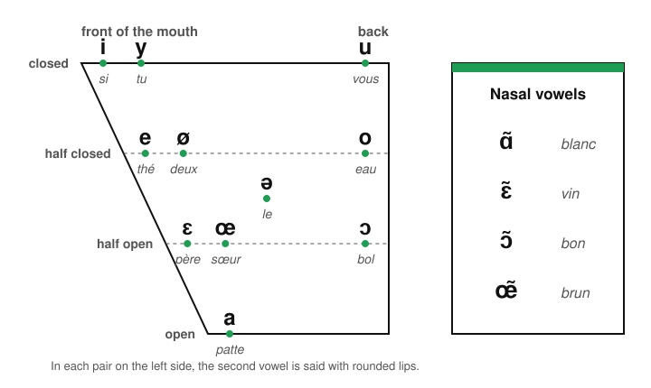

# IPA chart

This page lists every sound (phoneme) of standard French in the International Phonetic Alphabet (IPA), with how to make it, how it is usually spelled and two example words. Use it to look up a symbol you met in a dictionary or in a lesson. A short section at the end covers well-described features of Quebec pronunciation.

Lessons for these: [the vowels a, i, ou and u](../01-first-sounds-and-greetings/03-vowels-a-i-ou-u.md), [the e vowels](../01-first-sounds-and-greetings/04-vowels-e-family.md), [the vowels o and eu](../01-first-sounds-and-greetings/05-vowels-o-and-eu.md), [nasal vowels](../01-first-sounds-and-greetings/06-nasal-vowels.md), French consonants<!-- link: ../02-sounds-spelling-and-everyday-things/01-consonants.md --> and the French r and the semi-vowels<!-- link: ../02-sounds-spelling-and-everyday-things/02-r-and-semi-vowels.md -->.

## How to read the chart

A symbol in slashes, such as /y/, stands for a sound in the standard pronunciation. A symbol in square brackets, such as [t͡sy], stands for the exact sound a Quebec speaker makes. The comparisons with English are rough: they point you to the nearest English sound, and say where it stops working.

The vowel chart below places the oral vowels by tongue height (high at the top) and tongue position (front on the left), with example words.

## Oral vowels

An **oral vowel** is a vowel made with air coming out of the mouth only. French vowels stay steady: the mouth does not glide to a second vowel the way English "go" or "say" does.

| IPA | How to make it | Common spellings | Examples |
|---|---|---|---|
| /i/ | Like the vowel in English "see", but shorter, with the lips spread and no glide. | `i`, `î`, `y` | *si* /si/, *lit* /li/ |
| /y/ | No English match. Say /i/, keep the tongue where it is, then round the lips as for "oo". | `u`, `û` | *tu* /ty/, *rue* /ʁy/ |
| /u/ | Like the vowel in "food", but with tighter, more rounded lips and no glide. | `ou`, `où`, `oû` | *vous* /vu/, *rouge* /ʁuʒ/ |
| /e/ | Close to the vowel in "say" without the glide at the end. The mouth is nearly closed. | `é`, `er` or `ez` at the end of a word, `ai` in some endings | *été* /ete/, *les* /le/ |
| /ɛ/ | Like the vowel in "bed", with the mouth more open than for /e/. | `è`, `ê`, `ai`, `ei`, `e` before two consonants | *mère* /mɛʁ/, *fête* /fɛt/ |
| /ø/ | No English match. Say /e/, keep the tongue still, then round the lips. | `eu`, `œu` (at the end of a syllable) | *deux* /dø/, *peu* /pø/ |
| /œ/ | Like /ø/ but with the mouth more open. Close to the vowel in "her" without the r. | `eu`, `œu` (before a pronounced consonant) | *sœur* /sœʁ/, *peur* /pœʁ/ |
| /ə/ | A weak, rounded vowel, like the first sound of "the" in a fast "the apple", with the lips a little rounded. It is often dropped in speech. | `e` with no accent | *le* /lə/, *demain* /dəmɛ̃/ |
| /o/ | Like the vowel in "go", but without the glide to "oo". Hold the lips round and still. | `o` at the end of a word, `ô`, `au`, `eau` | *eau* /o/, *beaucoup* /boku/ |
| /ɔ/ | Like the vowel in "thought" in much of Canada, but shorter. | `o` before a pronounced consonant | *porte* /pɔʁt/, *homme* /ɔm/ |
| /a/ | Like the vowel in "father", but made further forward in the mouth. | `a`, `à`, `e` in `femme` | *la* /la/, *chat* /ʃa/ |
| /ɑ/ | A back "a", like "father". Many speakers in France have lost it and say /a/, but it remains in Quebec. | `â`, some words in `-as`, `-asse` | *pâte* /pɑt/, *âge* /ɑʒ/ |

Watch the difference between /e/ and /ɛ/, and between /ø/ and /œ/. English has no matching pairs, so they are easy to blur. The lesson on [the e vowels](../01-first-sounds-and-greetings/04-vowels-e-family.md) gives the rule of thumb: /e/ and /ø/ end a syllable, while /ɛ/ and /œ/ come before a pronounced consonant.

## Nasal vowels

A **nasal vowel** is a vowel made with air going through the nose and the mouth at once. Do not pronounce an *n* or *m* after it: *bon* /bɔ̃/ has no *n* sound. English has no matching sound; the vowel before "ng" in "sing" is the nearest, and you must not close it with the "ng".

| IPA | How to make it | Common spellings | Examples |
|---|---|---|---|
| /ɛ̃/ | Start from /ɛ/ and let the air go through the nose. | `in`, `im`, `ain`, `ein`, `ien` (`ien` /jɛ̃/) | *pain* /pɛ̃/, *vin* /vɛ̃/ |
| /ɑ̃/ | Start from /ɑ/ and let the air go through the nose. | `an`, `am`, `en`, `em` | *dans* /dɑ̃/, *temps* /tɑ̃/ |
| /ɔ̃/ | Start from /ɔ/ and let the air go through the nose, with the lips round. | `on`, `om` | *bon* /bɔ̃/, *nom* /nɔ̃/ |
| /œ̃/ | Start from /œ/ and let the air go through the nose. Many speakers merge it with /ɛ̃/. | `un`, `um` | *un* /œ̃/, *brun* /bʁœ̃/ |

## Semi-vowels

A **semi-vowel** (*une semi-voyelle*, also called a glide) is a vowel sound made so short that it acts like a consonant. It always sits next to a vowel in the same syllable.

| IPA | How to make it | Common spellings | Examples |
|---|---|---|---|
| /j/ | Like the "y" in English "yes". | `y`, `i` before a vowel, `il` or `ill` after a vowel | *yeux* /jø/, *pied* /pje/ |
| /w/ | Like the "w" in English "we". | `ou` before a vowel, `oi` | *oui* /wi/, *moi* /mwa/ |
| /ɥ/ | No English match. Say /y/ (the "u" of *tu*) as a very short sound before another vowel. | `u` before a vowel | *huit* /ɥit/, *nuit* /nɥi/ |

## Consonants

Most French consonants are close to English ones. The main differences are that stops (/p/, /t/, /k/) have no puff of air after them, that /t/ and /d/ touch the back of the upper teeth, and that the French r is not the English r.

| IPA | How to make it | Common spellings | Examples |
|---|---|---|---|
| /p/ | Like English "p" in "spin", with no puff of air. | `p`, `pp` | *papa* /papa/, *plus* /ply/ |
| /b/ | Like English "b". | `b`, `bb` | *bon* /bɔ̃/, *bébé* /bebe/ |
| /t/ | Like English "t" in "stop", with the tongue on the back of the upper teeth and no puff of air. | `t`, `tt`, `th` | *tête* /tɛt/, *table* /tabl/ |
| /d/ | Like English "d", with the tongue on the back of the upper teeth. | `d`, `dd` | *dans* /dɑ̃/, *radio* /ʁadjo/ |
| /k/ | Like English "k" in "skin", with no puff of air. | `c` before `a`, `o`, `u`; `qu`; `k`; `ch` in a few words | *café* /kafe/, *quoi* /kwa/ |
| /g/ | Like English "g" in "go". | `g` before `a`, `o`, `u`; `gu` before `e`, `i` | *gare* /gaʁ/, *gâteau* /gɑto/ |
| /f/ | Like English "f". | `f`, `ff`, `ph` | *feu* /fø/, *photo* /fɔto/ |
| /v/ | Like English "v". | `v`, `w` in some loanwords | *vous* /vu/, *vélo* /velo/ |
| /s/ | Like English "s" in "sip". | `s` at the start of a word, `ss`, `c` before `e`, `i`, `ç`, `t` in `-tion` | *sac* /sak/, *ça* /sa/ |
| /z/ | Like English "z". | `z`, `s` between two vowels | *zéro* /zeʁo/, *maison* /mɛzɔ̃/ |
| /ʃ/ | Like English "sh" in "ship". | `ch` | *chat* /ʃa/, *chien* /ʃjɛ̃/ |
| /ʒ/ | Like the "s" in English "measure". | `j`, `g` before `e`, `i` | *je* /ʒə/, *rouge* /ʁuʒ/ |
| /m/ | Like English "m". | `m`, `mm` | *mère* /mɛʁ/, *homme* /ɔm/ |
| /n/ | Like English "n", with the tongue on the back of the upper teeth. | `n`, `nn` | *nom* /nɔ̃/, *une* /yn/ |
| /ɲ/ | Like the "ny" in "canyon", as one sound. | `gn` | *montagne* /mɔ̃taɲ/, *ligne* /liɲ/ |
| /ŋ/ | Like "ng" in "sing". It appears only in words taken from English. | `ng` at the end of a word | *parking* /paʁkiŋ/, *camping* /kɑ̃piŋ/ |
| /l/ | Like the "l" in English "leaf", with the tip of the tongue on the back of the upper teeth. English "l" at the end of a word ("full") is darker and does not match. | `l`, `ll` | *lune* /lyn/, *il* /il/ |
| /ʁ/ | A rough sound made at the back of the throat, with the tongue tip behind the lower teeth. It is closest to a soft gargle or the "ch" of German "Bach". The English r does not match. | `r`, `rr` | *rue* /ʁy/, *garage* /gaʁaʒ/ |

The letter *h* is never pronounced in French (*homme* /ɔm/). The letter *x* is usually two sounds, /ks/ (*taxi* /taksi/) or /gz/ (*exemple* /ɛgzɑ̃pl/).

## Quebec pronunciation

Quebec speakers use the same phonemes, but several of them are pronounced differently. The features below are described in published work on Quebec French and are heard in everyday speech. They are given in square brackets because they show the exact sound. How strong each one is differs from speaker to speaker and from one region to another.

Affrication is the best known. The consonants /t/ and /d/ become **affricates** (a stop followed by a hiss in one sound) before the vowels /i/ and /y/ and before the semi-vowels /j/ and /ɥ/. So /ty/ is [t͡sy], and /di/ is [d͡zi].

| Feature | Standard | Quebec |
|---|---|---|
| Affrication of /t/ and /d/ before /i/, /y/, /j/, /ɥ/ | *tu* /ty/, *dire* /diʁ/ | *tu* [t͡sy], *dire* [d͡ziʁ] |
| Laxing of /i/, /y/, /u/ in closed syllables | *petite* /pətit/, *jupe* /ʒyp/, *route* /ʁut/ | *petite* [pət͡sɪt], *jupe* [ʒʏp], *route* [ʁʊt] |
| Long vowels in closed syllables diphthongise | *pâte* /pɑt/, *fête* /fɛt/ | *pâte* [pɑʊ̯t], *fête* [faɪ̯t] |
| /a/ and /ɑ/ stay different | *patte* /pat/, *pâte* /pɑt/ | *patte* [pat], *pâte* [pɑʊ̯t] |

Laxing means the vowel is made with a less tense tongue and sounds shorter and more open: [ɪ] is between /i/ and /ɛ/, [ʏ] is between /y/ and /œ/, and [ʊ] is between /u/ and /ɔ/. It happens when the vowel is short, in a syllable that ends in a consonant sound. It does not happen before /ʁ/, /ʒ/, /z/ or /v/, so *rouge* stays /ʁuʒ/.

A **diphthong** is a vowel that glides to a second vowel inside one syllable. In Quebec, long vowels in closed syllables, and also nasal vowels, often diphthongise, where standard French keeps them steady. The diphthongs with [ɪ], [ʊ] and [ʏ] are described as formal, and forms such as [ɑʊ̯] and [aɪ̯] as informal.

The contrast between /a/ and /ɑ/ is real in Quebec: *patte* and *pâte* are a minimal pair there. *La*, *ma*, *ta* and *sa* always have /a/.

Sources, checked 2026: [phono.quebec, affrication de /t/ et /d/](https://www.phono.quebec/rubriques/r01.html), a site by Quebec phoneticians first hosted at the Université du Québec à Chicoutimi, for affrication; and [the Wikipedia article on Quebec French phonology](https://en.wikipedia.org/wiki/Quebec_French_phonology), which cites the published studies, for laxing, diphthongs and the /a/ and /ɑ/ contrast. The lesson on Quebec vowels and diphthongs<!-- link: ../12-real-montreal/06-quebec-vowels-and-diphthongs.md --> covers them with audio.
